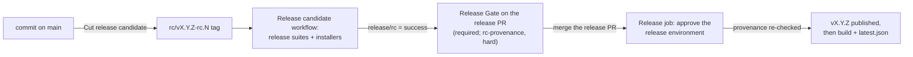

# Release candidates

A stable release ships only from a release candidate that passed. The order is always main, then a candidate, then the release:

Release-please still owns versions and the changelog. It keeps an open release PR whose manifest names the next version, X.Y.Z. A candidate is a tag on a commit of main, `rc/vX.Y.Z-rc.N`. Release-please never counts it as a release: with `include-component-in-tag: false` it ignores any tag that has a component, and `rc/` is one.

## Cut a candidate

1. Run **Cut release candidate** (`cut-release-candidate.yml`) from the Actions tab. Leave `commit` empty to take main's tip, or give a commit of main.
2. The workflow reads X.Y.Z from the release PR's branch (`release-please--branches--main`), picks the next N and creates the tag with the release app's token.
3. The tag push starts **Release candidate** (`release-candidate.yml`) at the tagged commit. It:
   - posts a pending `release/rc` commit status on the commit;
   - runs the release suites: the full journey matrix on Ubuntu (4 shards) and Windows (3 shards), the window runtime checks on Windows at 1920x1080 and on Linux X11, the macOS journeys, and Rust coverage;
   - creates a GitHub prerelease for the tag and builds the installers on it with `build-installers.yml`, the same workflow a release uses, stamped with the candidate's version X.Y.Z-rc.N (see [Candidate versions](#candidate-versions));
   - uploads the release's updater bundles and signatures; after every release suite and installer build succeeds, a separate job verifies their trusted-comment versions against X.Y.Z-rc.N before publishing the entry in the newest stable release's `latest.json`;
   - posts `release/rc` as success only when every suite and the installer build passed, and as failure otherwise.

The macOS journeys run but don't block yet: `tauri-plugin-webdriver` has no working macOS WebDriver on GitHub runners (#489). A red macOS leg shows in the run without failing the candidate.

Release candidates are also announced in the normal updater manifest attached to the newest stable release. Testers can enable **Include release candidates** in the app's update settings; it is off by default. With the setting on, the app offers the highest available version newer than the installed version. Stable installs from older versions ignore the optional `candidates` key and continue to see the top-level stable release as before. This does not change where candidates are installed from: testers may still install them from the prerelease page.

Candidate selection is provided by the newer updater client and its **Include release candidates** preference; older stable clients ignore the optional manifest key, so publishing candidates does not change their update behavior.

A failed candidate stays failed. Fix main, then cut the next candidate; N goes up by one.

### Candidate versions

A candidate is built as X.Y.Z-rc.N, so the app reports itself as a candidate, and the updater, which offers only a newer version, offers it X.Y.Z. `scripts/release/stamp-candidate-version.mjs` stamps the version and gives each installer the form its package manager needs, so that X.Y.Z replaces the candidate:

|Installer|Candidate version|Why|
|---|---|---|
|App, NSIS, AppImage|`X.Y.Z-rc.N`|Semver orders it below X.Y.Z, as the NSIS installer compares it.|
|MSI|`X.Y.Z.N` (`bundle.windows.wix.version`)|WiX takes numbers only. Windows Installer ignores the fourth field, so it sees X.Y.Z, and X.Y.Z's MSI replaces the candidate as a same-version upgrade.|
|macOS `.app`|`CFBundleShortVersionString` `X.Y.Z-rc.N`, `CFBundleVersion` `X.Y.Z`|Apple defines `CFBundleVersion` as numbers; X.Y.Z never ranks the candidate above the release.|
|deb|`X.Y.Z~rc.N`|dpkg reads `X.Y.Z-rc.N` as X.Y.Z with Debian revision `rc.N`, newer than X.Y.Z. The tilde sorts first.|
|rpm|Version `X.Y.Z`, Release `0.rc.N`|rpm forbids `-` in Version. Release `0.rc.N` sorts below the release's Release `1`.|

The bundler versions a deb and an rpm with the semver only, so on Linux the candidate's own build step bundles them: it repacks the deb with its Version, bundles the rpm with its Version and Release, and signs both for X.Y.Z-rc.N. A release builds every installer with tauri-action, unchanged.

## Release

1. When the candidate has passed, re-run **Release Gate** on the release PR. It usually ran, and failed, before the candidate finished, and a new commit status does not start it again. Its `rc-provenance` check is hard. It passes only when the newest candidate for X.Y.Z has a successful `release/rc` status, and the release PR differs from the candidate's commit only in release metadata:
   - `CHANGELOG.md`, any change;
   - `.release-please-manifest.json`, `apps/desktop/package.json` and `apps/desktop/src-tauri/tauri.conf.json`, the version only;
   - `apps/desktop/src-tauri/Cargo.toml`, the package version only, and `Cargo.lock`, the `desktop_shell` entry's version only.

   Any other change since the candidate, such as a new commit on main, fails the check: cut a new candidate from main's new tip.
2. Merge the release PR. Release Gate is a required check, so the merge button waits for it.
3. The merge's push to main starts **Release Please**. Its `release-please` job only maintains the release PR and never publishes. It sees that the manifest version moved and hands the commit to the `release` job, which waits for you to approve the `release` environment. Then it re-runs the provenance check on the merged commit, and only if that passes does release-please tag and publish `vX.Y.Z`. The installers build and `latest.json` publishes after that.

Release Gate is an early signal, but the `release` job is the check that decides. Release Gate can test an older merge result: branch protection does not require PRs to be up to date, release-please leaves its PR alone when the commits on main are ones the changelog hides (`ci`, `docs`, `chore` and others), and a re-run checks the run's original merge commit.

`scripts/release/check-rc-provenance.mjs` is the one implementation of the check, used by both gates. `node scripts/release/check-rc-provenance.test.mjs` tests the metadata rules.

### If the release job refuses

A refusal publishes nothing, so installed copies keep the previous release and nothing needs undoing. The merged release PR keeps its `autorelease: pending` label, and release-please opens no new release PR until that one is released. To finish the release:

1. Run **Cut release candidate** with `version` set to X.Y.Z, since the merged release PR no longer offers one, and `commit` set to the merged commit. Wait for the candidate to pass.
2. Re-run the failed **Release** job of that Release Please run. Approve the environment again; the check now passes, and the release publishes.

### If Release Please says a release PR is not published yet

Each run looks for a merged release PR still labelled `autorelease: pending`, and only the run for that PR's merge commit may publish it. When that run never got to its `release` job, for example because a newer push cancelled it while it waited in the concurrency queue, every later run fails with "Release PR #N merged as <commit> is not published yet". Re-run the **Release Please** run for that commit; it then goes through the `release` job as usual.

## What runs where

|Suite|PRs and merge queue|Push to main|Release candidate|Manual dispatch|
|---|---|---|---|---|
|L1+L2 tests (ci.yml), mock-mode Playwright, cargo-deny, perf baseline|yes|yes|no (already ran on main)|no|
|Real-UI smoke subset (3 journeys, Ubuntu)|yes, required|builds only, to keep caches warm|no|no|
|Full journey matrix, Ubuntu + Windows|no|no|yes|`e2e.yml`, `suite: release`|
|Window runtime checks, Windows + Linux X11|no|no|yes|`suite: release` or `window-runtime`|
|macOS journeys|no|no|yes, not blocking|`suite: release` or `macos`|
|Rust coverage|no|no|yes|`coverage.yml`|

## Owner setup

These settings live in the repository, not in the workflows:

1. **Settings, Environments: create `release` and add yourself as a required reviewer.** Without a reviewer the environment approves itself, and the `release` job publishes as soon as the check passes.
2. **Settings, Branches: add `Release Gate` to main's required status checks**, by running `scripts/branch-protection-main.sh apply` once this lands; `scripts/branch-protection-main.json` already lists it. As of 2026-10-27 it is reported but not required. The `Release Gate` job always runs and passes at once on PRs that aren't release PRs and on merge-queue entries, so only the release PR waits on it.
3. Optional: add a tag ruleset that limits who may create `rc/*` and `v*` tags. Anyone with write access can post a `release/rc` status or push a tag, so the gate protects against mistakes, not against someone with write access acting on purpose.
