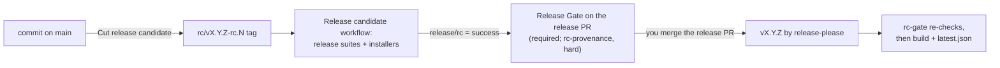

# Release candidates

A stable release ships only from a release candidate that passed. The order is always main, then a candidate, then the release:

Release-please still owns versions and the changelog. It keeps an open release PR whose manifest names the next version, X.Y.Z. A candidate is a tag on a commit of main, `rc/vX.Y.Z-rc.N`. Release-please never counts it as a release: with `include-component-in-tag: false` it ignores any tag that has a component, and `rc/` is one.

## Cut a candidate

1. Run **Cut release candidate** (`cut-release-candidate.yml`) from the Actions tab. Leave `commit` empty to take main's tip, or give a commit of main.
2. The workflow reads X.Y.Z from the release PR's branch (`release-please--branches--main`), picks the next N and creates the tag with the release app's token.
3. The tag push starts **Release candidate** (`release-candidate.yml`) at the tagged commit. It:
   - posts a pending `release/rc` commit status on the commit;
   - runs the release suites: the full journey matrix on Ubuntu (4 shards) and Windows (3 shards), the window runtime checks on Windows at 1920x1080 and on Linux X11, the macOS journeys, and Rust coverage;
   - creates a GitHub prerelease for the tag and builds the installers on it with `build-installers.yml`, the same workflow a release uses, stamped with X.Y.Z;
   - posts `release/rc` as success only when every suite and the installer build passed, and as failure otherwise.

The macOS journeys run but don't block yet: `tauri-plugin-webdriver` has no working macOS WebDriver on GitHub runners (#489). A red macOS leg shows in the run without failing the candidate.

A prerelease never becomes GitHub's latest release, and installed copies poll `releases/latest/download/latest.json`. So no installed copy is offered a candidate, and only the stable release writes `latest.json`. Testers install a candidate from its prerelease page.

A failed candidate stays failed. Fix main, then cut the next candidate; N goes up by one.

## Release

1. When the candidate has passed, re-run **Release Gate** on the release PR. It usually ran, and failed, before the candidate finished, and a new commit status does not start it again. Its `rc-provenance` check is hard. It passes only when the newest candidate for X.Y.Z has a successful `release/rc` status, and the release PR differs from the candidate's commit only in release metadata:
   - `CHANGELOG.md`, any change;
   - `.release-please-manifest.json`, `apps/desktop/package.json` and `apps/desktop/src-tauri/tauri.conf.json`, the version only;
   - `apps/desktop/src-tauri/Cargo.toml`, the package version only, and `Cargo.lock`, the `desktop_shell` entry's version only.

   Any other change since the candidate, such as a new commit on main, fails the check: cut a new candidate from main's new tip.
2. Merge the release PR. Release Gate is a required check, so the merge button waits for it, and your merge is the release's approval.
3. The merge makes release-please publish the `vX.Y.Z` release. Its `rc-gate` job re-runs the same check on the released commit, which takes seconds, and only then lets the installers build and `latest.json` publish.

`scripts/release/check-rc-provenance.mjs` is the one implementation of the check, used by both gates. `node scripts/release/check-rc-provenance.test.mjs` tests the metadata rules.

### If rc-gate refuses a release

This happens only when the release PR merged without a passing Release Gate. By then release-please has published `vX.Y.Z` with no installers and no `latest.json`, so installed copies' update checks fail. Re-running `rc-gate` cannot pass, because the commit stays the same. To recover:

1. Note the released commit (`git rev-list -n 1 vX.Y.Z`), then delete the `vX.Y.Z` release and its tag (`gh release delete vX.Y.Z --cleanup-tag`). Installed copies then see the previous release as the latest again.
2. Run **Cut release candidate** with `version` set to X.Y.Z, since the merged release PR no longer offers one, and `commit` set to the released commit. Wait for the candidate to pass.
3. On the merged release PR, swap the `autorelease: tagged` label back to `autorelease: pending`; release-please only publishes releases for PRs with the pending label. Then re-run the **Release Please** run that published `vX.Y.Z`, the one for the released commit. It publishes the release again, and `rc-gate` passes.

## What runs where

|Suite|PRs and merge queue|Push to main|Release candidate|Manual dispatch|
|---|---|---|---|---|
|L1+L2 tests (ci.yml), mock-mode Playwright, cargo-deny, perf baseline|yes|yes|no (already ran on main)|no|
|Real-UI smoke subset (3 journeys, Ubuntu)|yes, required|builds only, to keep caches warm|no|no|
|Full journey matrix, Ubuntu + Windows|no|no|yes|`e2e.yml`, `suite: release`|
|Window runtime checks, Windows + Linux X11|no|no|yes|`suite: release` or `window-runtime`|
|macOS journeys|no|no|yes, not blocking|`suite: release` or `macos`|
|Rust coverage|no|no|yes|`coverage.yml`|

## Owner setup

These settings live in the repository, not in the workflows:

1. **Settings, Branches: add `Release Gate` to main's required status checks**, by running `scripts/branch-protection-main.sh apply` once this lands; `scripts/branch-protection-main.json` already lists it. As of 2026-10-27 it is reported but not required. The `Release Gate` job always runs and passes at once on PRs that aren't release PRs and on merge-queue entries, so only the release PR waits on it.
2. Optional: add a tag ruleset that limits who may create `rc/*` and `v*` tags. Anyone with write access can post a `release/rc` status or push a tag, so the gate protects against mistakes, not against someone with write access acting on purpose.
